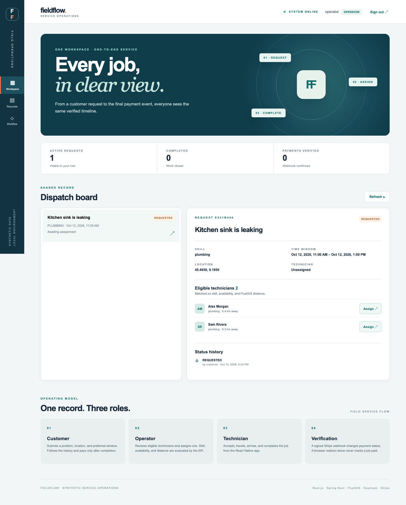
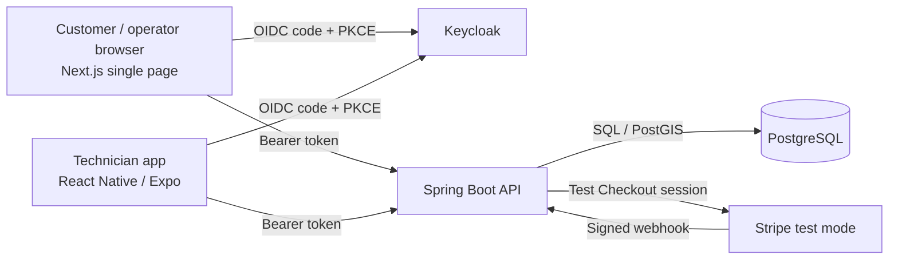

# FieldFlow — field service operations

FieldFlow coordinates a service request from intake through dispatch, technician completion, and test payment. The brand, people, requests, and locations in this repository are fictional. The portal keeps the customer and operator experience on one page; the technician app uses one work screen.



## Run locally

Requirements: Docker Desktop with Compose, Node.js 22, Java 21, Maven 3.9+, and (for the native app) Xcode with an iOS simulator. The application runs on `localhost` ports 3000, 8080, 8081, and 5433.

```bash
cp .env.example .env
docker compose up --build -d --wait
```

Open [the portal](http://localhost:3000) and sign in through Keycloak. The seeded accounts use the passwords from `.env`:

| Account | Role | Default local password | Purpose |
| --- | --- | --- | --- |
| `customer` | Customer | `customer-local` | Create requests, read own history, open test Checkout |
| `operator` | Operator | `operator-local` | See all work, rank and assign technicians |
| `alex`, `sam`, `jordan` | Technician | `technician-local` | Read assigned work and advance its status |

The initial request is a kitchen sink leak near central Milan. Alex and Sam are plumbers; Jordan is an electrician. Their availability covers the next year and their service radii differ. Create a new plumbing request at the prefilled coordinates to see both plumbers ranked by distance. These accounts and passwords are for local use only.

The API's [OpenAPI document](http://localhost:8081/v3/api-docs) and [Swagger UI](http://localhost:8081/swagger-ui/index.html) describe the HTTP contract. Unauthenticated requests to business endpoints return 401.

## Architecture



The [architecture notes](docs/architecture.md) cover data ownership, authorization, idempotency, matching, and payment trust boundaries.

## One request, three roles

1. The customer describes a problem, picks the required skill, enters WGS84 coordinates, and selects a future time window. The browser sends a fresh `Idempotency-Key` for each submission. A retry with identical content returns the same request; reusing the key with different content returns 409.
2. The operator selects a request. PostgreSQL/PostGIS filters technicians by skill, covering availability, service radius, and overlapping active work, then sorts by geographic distance. The assignment transaction locks the request and technician before updating the record and appending history.
3. The assigned technician signs in to the React Native app, accepts the job, marks travel and arrival, then completes it. The API owns the transition rules; the app only presents the next allowed action.
4. The customer and operator read the same append-only status history. A customer can only read their own requests; a technician can only read assigned work.
5. After completion, the customer can open Stripe Checkout in **test mode**. Returning from Checkout never marks the request paid. The API changes payment status only after validating the Stripe signature, event mode, stored Checkout session, amount, currency, and request reference.

| Current state | Allowed next state | Actor |
| --- | --- | --- |
| `REQUESTED` | `ASSIGNED` | Operator, after eligibility check |
| `ASSIGNED` | `ACCEPTED` | Assigned technician |
| `ACCEPTED` | `EN_ROUTE` | Assigned technician |
| `EN_ROUTE` | `ON_SITE` | Assigned technician |
| `ON_SITE` | `COMPLETED` | Assigned technician |
| `COMPLETED` | No work transition | — |

Repeating the same assignment or transition returns the existing state without another history row. All other jumps return 409. Payment has its own `UNPAID → PENDING → PAID` path.

## Technician app

The React Native app is in [`technician/`](technician/). It uses Expo AuthSession with authorization code + PKCE and stores tokens in SecureStore. It targets an **iOS simulator on the same Mac** as the Compose stack: the simulator can reach `localhost` and the local Keycloak issuer. A development build is required for the custom `fieldflow://auth` callback.

```bash
cd technician
npm ci
cp .env.example .env
npx expo run:ios
```

Use `alex` / `technician-local` after an operator assigns a plumbing request to Alex. For a physical device or Android emulator, set reachable host URLs in `technician/.env` and adjust Keycloak's advertised hostname and redirect configuration accordingly. Expo Go does not support this native callback scheme.

## Stripe test payment

Set `STRIPE_SECRET_KEY=sk_test_...` in `.env`, then restart the API. Only `sk_test_` keys are accepted. Run the Stripe CLI in a second terminal:

```bash
stripe login
stripe listen --forward-to localhost:8081/webhooks/stripe
```

Copy the displayed `whsec_...` signing secret into `STRIPE_WEBHOOK_SECRET` in `.env`, then recreate the API container:

```bash
docker compose up -d --force-recreate api
```

Finish a request, click **Open Stripe Checkout**, and use a [Stripe test card](https://docs.stripe.com/testing). The portal shows `PENDING` until the verified `checkout.session.completed` webhook arrives. A repeated Checkout request returns the stored session; a repeated webhook event changes no rows. Neither Stripe credentials nor payloads are logged by the app.

## Verify

```bash
./scripts/verify.sh
```

The script runs API integration tests against a Testcontainers PostGIS instance, checks both TypeScript projects, builds the portal, and runs the Playwright browser flow against the running Compose stack. To run parts individually:

```bash
cd api && mvn test
cd portal && npm ci && npm run typecheck && npm run build && npx playwright install chromium && npm run test:e2e
cd technician && npm ci && npm run typecheck && npx expo install --check && npx expo export --platform ios
```

The Playwright path signs in as all three roles, creates a request, assigns Alex, advances the technician's four states through the same protected API used by mobile, and checks that customer and operator see the same six history entries. API integration tests cover matching, role separation, invalid transitions, duplicate requests, repeated assignments, signed webhooks, and webhook replay. They use a local Checkout gateway stub, so CI needs no Stripe account or paid service.

## Technology and design choices

| Component | Role in the system |
| --- | --- |
| Next.js / React / TypeScript | One responsive portal page with customer and operator views driven by API state. |
| React Native / Expo | Single-screen technician workflow, native OIDC redirect, secure token storage. |
| Java / Spring Boot | REST API, validation, authorization, transaction boundaries, and OpenAPI. |
| PostgreSQL / PostGIS | Durable request timeline and geography-based eligibility using `ST_DWithin` and `ST_Distance`. |
| Keycloak / OpenID Connect | Seeded local identity provider. Public clients use authorization code with PKCE; Spring validates JWTs and maps realm roles. |
| Stripe Java SDK | Creates test Checkout sessions; a signature-verified webhook is the payment authority. |
| Docker Compose | Reproducible local database, identity provider, API, and portal. |
| Testcontainers / Playwright | Real PostGIS integration coverage and a browser-level cross-role journey. |
| GitHub Actions | Builds and checks all projects and runs the Compose-backed browser flow on every push and pull request. |

The API is the source of truth. Database uniqueness constraints protect request keys, Checkout sessions, and event IDs. Transactional row locks prevent concurrent assignments for the same technician and window. The timeline is append-only; the current request state is stored separately for fast reads.

## Limits

The matching model has one skill and one availability interval per technician, a fixed service radius, and straight-line geographic distance. There is no route-time estimation, rescheduling, cancellation, tax calculation, invoicing, push notification, or production tenancy. The seeded identity provider and passwords are intended for a local environment. Native OIDC URLs are configured for an iOS simulator; other devices need network and issuer configuration. The checkout price is fixed at €49.00. The browser E2E covers completion; the webhook and payment edge cases are checked in the API integration suite.

## Repository layout

```text
api/           Spring Boot API, schema, Testcontainers tests
portal/        Single-page Next.js portal, Playwright browser test
technician/    Single-screen Expo / React Native app
infra/keycloak Seeded local OIDC realm and accounts
docs/          Architecture notes and captured portal screenshot
scripts/       One-command local verification
compose.yaml   Local stack
```
